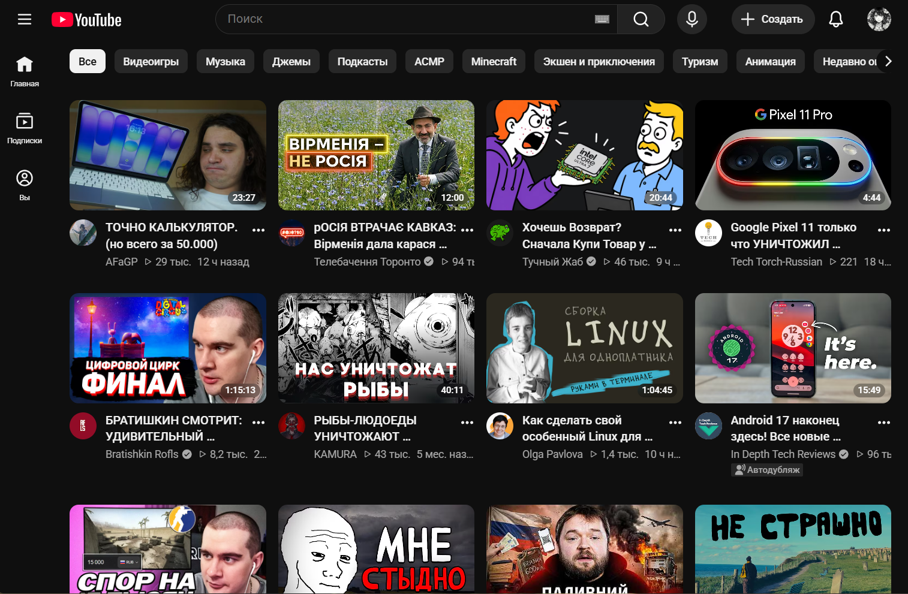

# uBlock-YT

<p align="center">
  
</p>

<p align="center">
    <a href="https://github.com/a111et/ublock-yt/blob/main/README.md"></a>
  <a href="https://github.com/a111et/ublock-yt/stargazers"></a>
  <a href="https://github.com/a111et/ublock-yt/issues"></a>
  <a href="https://subscribe.adblockplus.org/?location=https://raw.githubusercontent.com/a111et/ublock-yt/refs/heads/main/ublock-YT-Clinin.txt&title=uBlock-YT%20Filters"></a>
</p>

---

## 🎯 Цель проекта
Главная задача этого проекта — сделать YouTube чище, аккуратнее и удобнее в использовании. Он направлен на удаление отвлекающих элементов, алгоритмического мусора и дефектов верстки. 

*Планы на будущие обновления:* Пользовательские темы (скины) и специализированные пользовательские скрипты для дальнейшего улучшения или настройки интерфейса.

## 📦 Что это такое?
Этот репозиторий содержит тщательно подобранную коллекцию пользовательских правил для **uBlock Origin**, созданных специально для YouTube. Он нацелен на устранение раздражающих элементов интерфейса, лишнего мусора и сдвигов верстки, которые остаются после стандартной блокировки рекламы.

> [!TIP]
> Большое спасибо за использование моих фильтров! Если вы заметите какие-либо баги, нарушения верстки или у вас есть предложения по улучшению, пожалуйста, откройте Issue или Pull Request с вашим решением. Я с радостью добавлю его в общий список. Наслаждайтесь чистым YouTube!

---

## 🚀 Быстрая настройка и установка

### Вариант 1: Автоматическая подписка (рекомендуется)
Нажмите на кнопку ниже, чтобы автоматически импортировать список фильтров и подписаться на него в uBlock Origin:

[](https://subscribe.adblockplus.org/?location=https%3A%2F%2Fraw.githubusercontent.com%2Fa111et%2Fublock-yt%2Frefs%2Fheads%2Fmain%2Fublock-YT-Clinin.txt&title=uBlock-YT+Filters)

### Вариант 2: Ручной импорт
1. Скопируйте ссылку на исходный файл фильтров: `https://raw.githubusercontent.com/a111et/ublock-yt/refs/heads/main/ublock-YT-Clinin.txt`
2. Откройте **Панель управления uBlock Origin** -> вкладку **Списки фильтров**.
3. Прокрутите страницу вниз, установите флажок **Имровать...** (Import...), вставьте ссылку и нажмите **Применить изменения**.

---

## 🛠️ Разбор включенных правил

### 1. Улучшенная сетка (4 видео в ряд)
Принудительно отображает ровно 4 видео в ряд на главной странице YouTube для лучшей видимости и менее тесного вида.


```adblock
youtube.com##ytd-rich-grid-renderer:style(--ytd-rich-grid-items-per-row: 4 !important;)
youtube.com##ytd-rich-grid-renderer:style(--ytd-rich-grid-posts-per-row: 4 !important;)
youtube.com##ytd-two-column-browse-results-renderer.grid-6-columns:style(width: 100% !important;)
youtube.com##ytd-two-column-browse-results-renderer.grid:not(.grid-disabled):style(max-width: 100% !important;)
youtube.com##ytd-rich-grid-renderer, html:style(--ytd-rich-grid-slim-items-per-row: 7 !important;)
youtube.com##ytd-rich-grid-renderer, html:style(--ytd-rich-grid-game-cards-per-row: 7 !important;)
youtube.com##+js(set-attr, ytd-rich-shelf-renderer, is-show-more-hidden)
youtube.com##+js(ra, hidden, ytd-rich-item-renderer, stay)

```

### 2. Исправление пустых блоков-заглушек

Удаляет пустые пространства и сломанные блоки-контейнеры, которые появляются на главной странице после скрытия рекламы.

```adblock
youtube.com##ytd-rich-section-renderer.style-scope.ytd-rich-grid-renderer

```

### 3. Полная блокировка Shorts

Полностью удаляет YouTube Shorts из настольного и мобильного интерфейсов, включая боковую панель, полки на главной странице, подписки, результаты поиска и историю просмотров.

```adblock
! YT - Главная страница и Подписки (Сетка) - Скрыть раздел Shorts
youtube.com##[is-shorts]
! YT - Меню - Скрыть кнопку Shorts
[www.youtube.com](https://www.youtube.com)###guide [title="Shorts"], .ytd-mini-guide-entry-renderer[title="Shorts"]
! YT - Поиск - Скрыть Shorts
[www.youtube.com](https://www.youtube.com)##ytd-search ytd-video-renderer:has([overlay-style="SHORTS"],[href^="/shorts/"])
! YT - Поиск, Каналы, Подписки (Список) и Боковая панель / Рекомендации под плеером - Скрыть разделы Shorts
[www.youtube.com](https://www.youtube.com)##ytd-reel-shelf-renderer
! YT - Каналы - Скрыть вкладку Shorts
[www.youtube.com](https://www.youtube.com)##[tab-title="Shorts"]
! YT - Подписки - Скрыть Shorts (Сетка)
[www.youtube.com](https://www.youtube.com)##ytd-browse[page-subtype="subscriptions"] ytd-grid-video-renderer:has([overlay-style="SHORTS"],[href^="/shorts/"])
! YT - Подписки - Скрыть Shorts (Список)
[www.youtube.com](https://www.youtube.com)##ytd-browse[page-subtype="subscriptions"] ytd-video-renderer:has([overlay-style="SHORTS"],[href^="/shorts/"])
! YT - Подписки - Новый макет - Скрыть Shorts
[www.youtube.com](https://www.youtube.com)##ytd-browse[page-subtype="subscriptions"] ytd-rich-item-renderer:has([overlay-style="SHORTS"],[href^="/shorts/"])
! YT - Боковая панель - Скрыть Shorts
[www.youtube.com](https://www.youtube.com)###related :is(ytd-compact-video-renderer,yt-lockup-view-model):has([overlay-style="SHORTS"],[href^="/shorts/"])
! YT - История - Скрыть Shorts
[www.youtube.com](https://www.youtube.com)##ytd-item-section-renderer[page-subtype]:has(>#contents>[is-history]>#dismissible>ytd-thumbnail>#thumbnail[href^="/shorts/"])

! YT Mobile - Скрыть кнопку меню Shorts
m.youtube.com##ytm-pivot-bar-item-renderer:has(>.pivot-shorts)
! YT Mobile - Скрыть разделы Shorts
m.youtube.com##:is(ytm-rich-section-renderer,grid-shelf-view-model):has([href^="/shorts/"])
! YT Mobile - Поиск - Скрыть Shorts
m.youtube.com##ytm-search ytm-video-with-context-renderer:has([href^="/shorts/"])
! YT Mobile - Каналы - Скрыть кнопку Shorts
m.youtube.com##[tab-title="Shorts"]
! YT Mobile - История - Скрыть Shorts
m.youtube.com##[tab-identifier="FEhistory"] ytm-compact-video-renderer:has(>div>a[href^="/shorts/"])

```

### 4. Скрытие записей сообщества на главной странице

Блокирует текстовые и графические записи сообщества, чтобы они не загромождали вашу ленту видео.

```adblock
! YT Главная страница - Скрыть раздел публикаций
[www.youtube.com](https://www.youtube.com)##ytd-browse[page-subtype="home"] ytd-rich-section-renderer:has(ytd-rich-item-renderer[is-post])
! YT Главная страница - Скрыть публикации
[www.youtube.com](https://www.youtube.com)##ytd-browse[page-subtype="home"] ytd-rich-item-renderer[is-post]

```

### 5. Очистка интерфейса (Чистый плеер)

Очищает перегруженный ряд кнопок под видеоплеером («Спонсорство»/«Спросить», «Спасибо», «Клип», «Скачать» и т. д.), оставляя фокус исключительно на видеоконтенте.

```adblock
! YT - Кнопки под плеером - Спросить
[www.youtube.com](https://www.youtube.com)###top-row.ytd-watch-metadata yt-button-view-model:has([aria-label="Ask"])
! YT - Кнопки под плеером - Спасибо
[www.youtube.com](https://www.youtube.com)###top-row.ytd-watch-metadata yt-button-view-model:has([aria-label="Thanks"])
! YT - Кнопки под плеером - Поделиться
[www.youtube.com](https://www.youtube.com)###top-row.ytd-watch-metadata yt-button-view-model:has([aria-label="Share"])
! YT - Кнопки под плеером - Скачать
[www.youtube.com](https://www.youtube.com)###top-row.ytd-watch-metadata ytd-download-button-renderer
! YT - Кнопки под плеером - Клип
[www.youtube.com](https://www.youtube.com)###top-row.ytd-watch-metadata yt-button-view-model:has([aria-label="Clip"])
! YT - Кнопки под плеером - Еще
[www.youtube.com](https://www.youtube.com)###top-row.ytd-watch-metadata [aria-label="More actions"]
    ! YT - Кнопки под плеером - Еще: Спросить
    [www.youtube.com](https://www.youtube.com)##ytd-menu-service-item-renderer:has([d^="M480-80q0-83-31.5-156T363-363q-54-54-127-85.5T80-480q83"])
    ! YT - Кнопки под плеером - Еще: Спасибо
    [www.youtube.com](https://www.youtube.com)##ytd-menu-service-item-renderer:has([d^="M16.25 2A6.7 6.7 0 0012 3.509 6.75 6.75"])
    ! YT - Кнопки под плеером - Еще: Клип
    [www.youtube.com](https://www.youtube.com)##ytd-menu-service-item-renderer:has([d^="M6 2.002a4 4 0 102.03 7.445L10.586"])
    ! YT - Кнопки под плеером - Еще: Скачать
    [www.youtube.com](https://www.youtube.com)##ytd-menu-service-item-download-renderer
    ! YT - Кнопки под плеером - Еще: Пожаловаться
    [www.youtube.com](https://www.youtube.com)##ytd-menu-service-item-renderer:has([d^="m4 2.999-.146.073A1.55 1.55 0 003 4.454v16.545a1"])

```

### 6. Очищенные результаты поиска

Возвращает странице результатов поиска классический вид, отображая **только реальные видео, каналы и плейлисты**, при этом скрывая предложенные блоки, раздел «Другие зрители также искали» и прочие ловушки алгоритмов.

```adblock
! YT Поиск - оставлять только видео (без shorts)
youtube.com##ytd-search ytd-item-section-renderer>#contents>:is(:not(ytd-video-renderer,yt-showing-results-for-renderer,[icon-name="promo-full-height:EMPTY_SEARCH"]),ytd-video-renderer:has([aria-label="Shorts"])),ytd-secondary-search-container-renderer

! YT Поиск - оставлять только видео (без shorts) и каналы
youtube.com##ytd-search ytd-item-section-renderer>#contents>:is(:not(ytd-video-renderer,ytd-channel-renderer,yt-showing-results-for-renderer,[icon-name="promo-full-height:EMPTY_SEARCH"]),ytd-video-renderer:has([aria-label="Shorts"])),ytd-secondary-search-container-renderer

! YT Поиск - оставлять только видео (без shorts), каналы и плейлисты
youtube.com##ytd-search ytd-item-section-renderer>#contents>:is(:not(ytd-video-renderer,ytd-channel-renderer,ytd-playlist-renderer,yt-lockup-view-model,yt-showing-results-for-renderer,[icon-name="promo-full-height:EMPTY_SEARCH"]),ytd-video-renderer:has([aria-label="Shorts"])),ytd-secondary-search-container-renderer

```

---

## 🔗 Оцените мои другие проекты

Если вам понравился этот проект, обратите внимание на **[Downloader](https://github.com/a111et/Downloader)** — расширение для браузера, которое добавляет кнопки быстрого скачивания видео и фото в контекстное меню для многих веб-сайтов, включая YouTube.

## 🤝 Авторы и благодарности

* Спасибо сообществу за решения, найденные на [r/uBlockOrigin Wiki](https://www.reddit.com/r/uBlockOrigin/wiki/solutions/youtube/)
* Разработано и поддерживается [@a111et](https://github.com/a111et)
